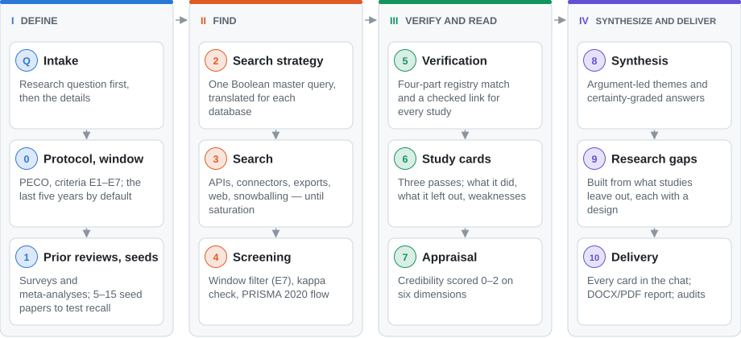
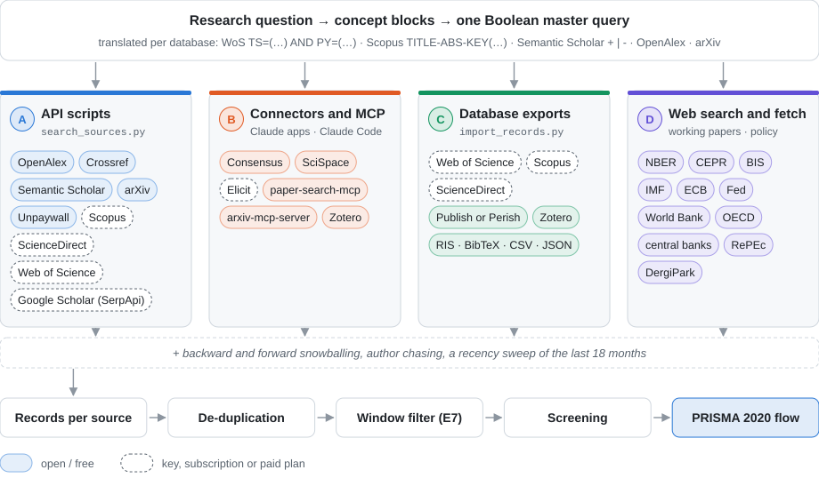
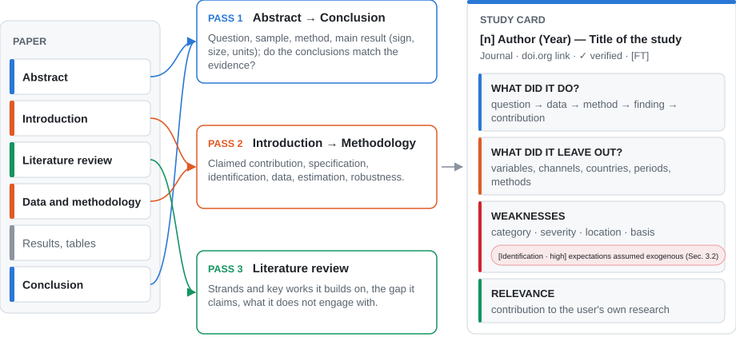
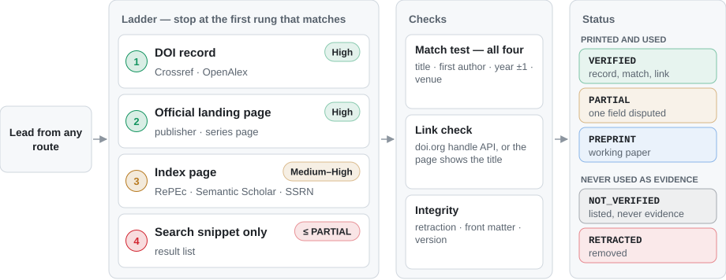
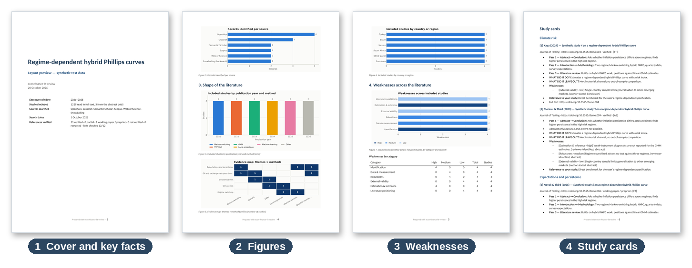

# Economics & Finance Literature Review

**An Agent Skill for Claude that conducts systematic, link-verified literature reviews in economics and finance**

[](https://github.com/ibrahimongoren/econ-finance-lit-review/actions/workflows/ci.yml)
[](CHANGELOG.md)
[](LICENSE)
[](.github/workflows/ci.yml)
[](https://doi.org/10.1136/bmj.n71)

> **Abstract.** `econ-finance-lit-review` turns a research question into a documented systematic
> review. It elicits the research question before any other detail, fixes a publication window
> (the years the user specifies or, by default, the last five years), and searches bibliographic
> databases, AI search engines, working-paper series and citation networks with a single translated
> search strategy. Every study is verified against Crossref, OpenAlex or the publisher's record and
> read in three passes. The output comprises a certainty-graded answer to each research question; a
> card for every included study stating what it did, what it left out and where it is weak; a
> PRISMA 2020 audit trail; and, on request, an illustrated DOCX/PDF report.

**Contents** — [1 Overview](#1-overview) · [2 Getting started](#2-getting-started) ·
[3 Search architecture](#3-search-architecture) · [4 Study cards](#4-study-cards-and-weakness-analysis) ·
[5 Verification](#5-verification) · [6 Outputs](#6-outputs) · [7 Helper scripts](#7-helper-scripts) ·
[8 Repository structure](#8-repository-structure) · [9 Limitations](#9-limitations-and-responsible-use) ·
[10 Standards](#10-methodological-standards) · [11 Citation](#11-citation) ·
[12 Contributing and license](#12-contributing-and-license)

---

## 1. Overview

The skill is designed for researchers who need a defensible answer to an empirical question —
graduate students preparing a thesis chapter, academic economists, and analysts at central banks
and international financial institutions. Its principal features are:

- **Question-first intake.** The research question is settled before scope, data, methods and
  output format are discussed.
- **A fixed publication window.** Every study inside the window is screened, verified and
  summarized; earlier canonical works are verified and cited as background.
- **Multi-route search.** One Boolean strategy is executed across databases, AI search engines,
  working-paper and policy series, and citation networks, until recall and saturation criteria
  are met.
- **Registry-based verification.** No reference is printed unless it matches an authoritative
  record and its link has been checked during the review.
- **Three-pass reading with weakness analysis.** Each study is summarized in a structured card
  with grounded weaknesses in ten methodological categories.
- **Graded synthesis.** Answers carry a GRADE-style certainty rating; research gaps are derived
  from what the studies leave out; comparable estimates can be pooled in a meta-analysis.

The workflow comprises an intake and eleven stages grouped into four phases (Figure 1). Each stage
writes a numbered file, so that long reviews can be paused and resumed and every reported number
can be traced to its stage and source.

<p align="center">
  <picture>
    <source media="(prefers-color-scheme: dark)" srcset="docs/assets/fig1-pipeline-en-dark.svg">
    
  </picture>
</p>
<p align="center"><sub><b>Figure 1.</b> Review pipeline. The publication window defaults to the last five years
(2021–2026 for a review conducted in 2026). Progress is reported at three checkpoints; the pipeline
pauses only if the question remains unclear or verification fails at scale.</sub></p>

## 2. Getting started

### Requirements

- Claude with code execution enabled (skills are available on the Free, Pro, Max, Team and
  Enterprise plans) or Claude Code.
- Python 3.9 or later for the helper scripts. Search and import use the standard library only;
  figures, the evidence workbook and the report use matplotlib, openpyxl and python-docx.
- Optional: pandoc and LibreOffice for the styled DOCX and PDF report; API keys and MCP servers
  for subscription databases and AI search engines (see [`integrations/`](integrations/README.md)).

### Installation

| Environment | Steps |
|---|---|
| Claude apps (web, desktop) | Download `econ-finance-lit-review.zip` from [Releases](https://github.com/ibrahimongoren/econ-finance-lit-review/releases). In **Customize › Skills**, select **+ › Create skill › Upload a skill**, choose the archive and enable the skill ([Use skills in Claude](https://support.claude.com/en/articles/12512180-use-skills-in-claude)). |
| Claude Code (plugin) | `/plugin marketplace add ibrahimongoren/econ-finance-lit-review`, then `/plugin install econ-finance-lit-review@econ-research-skills`. |
| Claude Code (manual) | Copy `skills/econ-finance-lit-review/` to `~/.claude/skills/` (all projects) or to `.claude/skills/` in a repository (that project only). |
| Integrations (optional) | Connect Consensus, Elicit or SciSpace as connectors; configure API keys and MCP servers as described in [`integrations/README.md`](integrations/README.md). |

### A first review

A review opens with the research question and then collects the remaining details:

```text
User:   Literature review on monetary policy transmission through bank lending in
        emerging markets.
Claude: What is your research question? (One sentence is enough.)
User:   Does monetary tightening reduce bank credit growth more in emerging markets with
        high dollarization?
Claude: A few details (blank = default): years (2021–2026) · variables · data and frequency ·
        countries · methods · papers you already know · database access · output: study
        cards in the chat, plus a report as DOCX, PDF or both?
```

If the opening request already contains these details, the skill confirms its understanding and
proceeds without further questions.

## 3. Search architecture

One Boolean master query is written for each combination of concept blocks and translated into
the syntax of each database (Figure 2). Four routes feed a single record set: API scripts,
research connectors and MCP servers, database exports supplied by the user, and domain-filtered
web search of working-paper and policy series. Backward and forward citation chasing and a recency
sweep complete the search. Records are de-duplicated, filtered by publication window (exclusion
code E7) and screened under PRISMA 2020.

<p align="center">
  <picture>
    <source media="(prefers-color-scheme: dark)" srcset="docs/assets/fig2-search-en-dark.svg">
    
  </picture>
</p>
<p align="center"><sub><b>Figure 2.</b> Search architecture. Sources drawn with a dashed outline require an API key,
an institutional subscription or a paid plan (for example, the Scopus and ScienceDirect APIs, Web of
Science and Elicit API access).</sub></p>

All access follows the providers' terms of use: shadow libraries, CAPTCHA or bot-detection
workarounds and Google Scholar scraping are excluded, and API keys are never displayed. AI search
engines support discovery alongside, not in place of, reproducible Boolean database searches.
Endpoints, rate limits and configuration files are documented in
[`source-access.md`](skills/econ-finance-lit-review/references/source-access.md) and
[`integrations/`](integrations/README.md).

## 4. Study cards and weakness analysis

Each included study inside the publication window is read in three passes and summarized in a
structured card (Figure 3). The second and third passes require the full text; legal open-access
copies are located through Unpaywall, OpenAlex and Semantic Scholar, and studies available only as
abstracts are labeled `[AB]`.

<p align="center">
  <picture>
    <source media="(prefers-color-scheme: dark)" srcset="docs/assets/fig3-reading-en-dark.svg">
    
  </picture>
</p>
<p align="center"><sub><b>Figure 3.</b> Three-pass reading and the resulting study card. Cards are written in the
language of the request; English and Turkish labels are built in.</sub></p>

Every study receives at least one weakness, recorded with its severity (high, medium or low), the
location that evidences it (section, table, page or abstract) and its basis (stated by the authors
or identified by the reviewer). Limits of scope are recorded under *what it left out*; flaws in the
analysis are recorded as *weaknesses*.

**Table 1.** Weakness taxonomy

| Category | Issues examined |
|---|---|
| Question and contribution | overstated contribution; conclusions framed more broadly than the design supports |
| Theory and specification | ad hoc specification; omitted variables required by theory |
| Identification | endogenous expectations or slack measures; weak or invalid instruments; reverse causality |
| Data and measurement | proxy variables, interpolated frequencies, short samples, unmodeled breaks, index construction |
| Estimation and inference | standard errors, unreported diagnostics, overfitting, look-ahead bias |
| Robustness | single specification; number of regimes or lags fixed without testing |
| External validity | generalization from one country or period; advanced-economy results applied to emerging markets |
| Literature positioning | omission of relevant contemporary work; claimed gaps that are not gaps |
| Transparency and replication | data or code unavailable; transformations insufficiently documented |
| Policy interpretation | conclusions beyond the evidence; uncertainty disregarded |

Recurring weaknesses inform the synthesis — they lower certainty or explain disagreement between
studies — and, together with what the studies leave out, form the basis of the ranked research
gaps.

## 5. Verification

Fabricated references are indistinguishable from genuine ones by appearance; only resolution
against an authoritative registry detects them. Every candidate reference, whatever its route,
proceeds through a verification ladder and must pass a four-part match test and a link check
before it can be cited (Figure 4).

<p align="center">
  <picture>
    <source media="(prefers-color-scheme: dark)" srcset="docs/assets/fig4-verification-en-dark.svg">
    
  </picture>
</p>
<p align="center"><sub><b>Figure 4.</b> Verification ladder, checks and reference statuses. Sources classified as
<code>NOT_VERIFIED</code> or <code>RETRACTED</code> are listed separately and are never used as evidence.</sub></p>

## 6. Outputs

Results are always delivered in the conversation: the answers first, then a summary of the corpus,
**every study card with its verified link**, the recurring weaknesses and the research gaps. On
request, the review is also compiled into a DOCX and/or PDF report with a key-facts cover page,
linked contents, numbered figures, all study cards and an APA 7 reference list (Figure 5).

<p align="center">
  
</p>
<p align="center"><sub><b>Figure 5.</b> Report layout produced by <code>build_report.py</code> from the synthetic test
data in <code>tests/demo_data.py</code>. The studies shown are fictional and illustrate the layout only.</sub></p>

Each review is stored in a self-contained working folder:

```text
litrev-<topic>/
├── 00_protocol.md … 02_search_log.csv     question, window, criteria, routes, queries
├── 03_records*.csv, 04_screening.csv      records per source, decisions, PRISMA flow
├── 05_verification.csv                    verified metadata, checked link, status
├── 06_study_cards.csv, 06_weaknesses.csv  three passes, did / left out, weaknesses
├── 07_appraisal.csv … 09_gaps.md          credibility, synthesis, research gaps
├── 10_report.docx / 10_report.pdf         illustrated report (figures in 10_figures/)
└── evidence_workbook.xlsx                 every table in one workbook
```

## 7. Helper scripts

The scripts are optional: without Python, the skill follows the same procedure manually using the
file schemas in its reference documents.

**Table 2.** Helper scripts by stage

| Stage | Script | Purpose |
|---|---|---|
| 0 | `init_review.py` | Working folder, protocol template (English/Turkish), publication window, report skeleton |
| 2–3 | `search_sources.py` | Multi-database search within the window; query translation; `--dry-run`, `--print-queries` |
| 3 | `import_records.py` | Import of WoS, Scopus, ScienceDirect, RIS, BibTeX, Publish or Perish, Zotero and connector JSON |
| 3 | `dedupe_records.py`, `coverage_check.py` | De-duplication and working-paper links; seed recall and saturation |
| 4 | `screening_check.py`, `prisma_flow.py` | Window exclusions and blind re-screen with Cohen's kappa; PRISMA 2020 flow diagram |
| 5 | `verify_refs.py` | Batch verification against Crossref, OpenAlex and doi.org |
| 6 | `find_fulltext.py`, `study_cards.py` | Legal open-access copies; study cards — creation, validation, chat batches, statistics |
| 8 | `meta_analysis.py` | Fixed and random effects, FAT–PET–PEESE, WAAP, moderators, funnel plot |
| 10 | `make_figures.py`, `build_report.py` | Report figures; DOCX (pandoc or python-docx) and PDF (LibreOffice) |
| 10 | `format_references.py`, `audit_citations.py`, `export_workbook.py` | APA 7 list from verified metadata; citation audit; Excel workbook |

## 8. Repository structure

```text
.claude-plugin/                  plugin and marketplace manifests (Claude Code)
.github/                         CI workflow, issue forms, pull request template
skills/econ-finance-lit-review/
├── SKILL.md                     workflow and rules (the skill itself)
├── references/                  source access, study cards, reporting, sources, methods,
│                                synthesis, templates, verified methodological anchors
└── scripts/                     helper scripts (Python 3)
integrations/                    MCP and Claude Desktop examples, permissions, .env.example
docs/assets/                     README figures
tests/                           pytest suite with mocked APIs and synthetic data
tools/                           archive builder, figure generator, repository-owner setup
```

## 9. Limitations and responsible use

- **Coverage depends on access.** Subscription databases, paywalled full texts, plan limits of AI
  search engines and API rate limits restrict what a session can reach; every such restriction is
  reported in the methods section.
- **Weaknesses are informed judgments.** Each is tied to a location in the paper and labeled by
  basis, but the cards do not substitute for peer review; abstract-only cards are marked as such.
- **Semantic search is not reproducible.** Dates, query phrasings and result caps are logged;
  completeness rests on the Boolean database searches.
- **Single screener.** A blind re-screen with Cohen's kappa partly substitutes for a second human
  screener; publication-grade reviews should add one.
- **Verification is not reading.** Users should read the key studies themselves, remain
  responsible for submitted work, and disclose the use of AI tools where their institution or
  journal requires it.

## 10. Methodological standards

The workflow implements the following reporting and methodological standards.

1. Page, M. J., McKenzie, J. E., Bossuyt, P. M., Boutron, I., Hoffmann, T., Mulrow, C. D., Shamseer, L., Tetzlaff, J., Akl, E. A., Brennan, S., Chou, R., Glanville, J., Grimshaw, J., Hróbjartsson, A., Lalu, M. M., Li, T., Loder, E., Mayo-Wilson, E., McDonald, S., . . . Moher, D. (2021). The PRISMA 2020 statement: An updated guideline for reporting systematic reviews. *BMJ, 372*, n71. https://doi.org/10.1136/bmj.n71
2. Rethlefsen, M. L., Kirtley, S., Waffenschmidt, S., Ayala, A. P., Moher, D., Page, M. J., Koffel, J. B., & PRISMA-S Group. (2021). PRISMA-S: An extension to the PRISMA statement for reporting literature searches in systematic reviews. *Systematic Reviews, 10*(1), 39. https://doi.org/10.1186/s13643-020-01542-z
3. Guyatt, G. H., Oxman, A. D., Vist, G. E., Kunz, R., Falck-Ytter, Y., Alonso-Coello, P., & Schünemann, H. J. (2008). GRADE: An emerging consensus on rating quality of evidence and strength of recommendations. *BMJ, 336*(7650), 924–926. https://doi.org/10.1136/bmj.39489.470347.AD
4. Havránek, T., Stanley, T. D., Doucouliagos, H., Bom, P. R. D., Geyer-Klingeberg, J., Iwasaki, I., Reed, W. R., Rost, K., & van Aert, R. C. M. (2020). Reporting guidelines for meta-analysis in economics. *Journal of Economic Surveys, 34*(3), 469–475. https://doi.org/10.1111/joes.12363
5. Iršová, Z., Doucouliagos, H., Havránek, T., & Stanley, T. D. (2024). Meta-analysis of social science research: A practitioner's guide. *Journal of Economic Surveys, 38*(5), 1547–1566. https://doi.org/10.1111/joes.12595
6. Stanley, T. D., & Doucouliagos, H. (2014). Meta-regression approximations to reduce publication selection bias. *Research Synthesis Methods, 5*(1), 60–78. https://doi.org/10.1002/jrsm.1095
7. DerSimonian, R., & Laird, N. M. (1986). Meta-analysis in clinical trials. *Controlled Clinical Trials, 7*(3), 177–188. https://doi.org/10.1016/0197-2456(86)90046-2
8. Higgins, J. P. T., & Thompson, S. G. (2002). Quantifying heterogeneity in a meta-analysis. *Statistics in Medicine, 21*(11), 1539–1558. https://doi.org/10.1002/sim.1186
9. Cohen, J. (1960). A coefficient of agreement for nominal scales. *Educational and Psychological Measurement, 20*(1), 37–46. https://doi.org/10.1177/001316446002000104
10. Wohlin, C. (2014). Guidelines for snowballing in systematic literature studies and a replication in software engineering. In *Proceedings of the 18th International Conference on Evaluation and Assessment in Software Engineering* (pp. 1–10). https://doi.org/10.1145/2601248.2601268
11. Keshav, S. (2007). How to read a paper. *ACM SIGCOMM Computer Communication Review, 37*(3), 83–84. https://doi.org/10.1145/1273445.1273458

All entries were verified against Crossref or OpenAlex; the complete list is maintained in
[`methodological_anchors.md`](skills/econ-finance-lit-review/references/methodological_anchors.md).

## 11. Citation

If this skill supports your research, please cite it. GitHub's **Cite this repository** button
uses [`CITATION.cff`](CITATION.cff); the equivalent BibTeX entry is:

```bibtex
@software{ongoren_econ_finance_lit_review_2026,
  author  = {Öngören, İbrahim},
  title   = {econ-finance-lit-review: Systematic, link-verified literature reviews
             for economics and finance},
  year    = {2026},
  version = {2.0.0},
  license = {MIT},
  url     = {https://github.com/ibrahimongoren/econ-finance-lit-review}
}
```

## 12. Contributing and license

Contributions are welcome, in particular regional source packs, import formats for further
databases, worked examples for the weakness taxonomy, template translations and reports of any
case in which an unverified or mismatched reference passed the checks. Please read
[CONTRIBUTING.md](CONTRIBUTING.md) and the [Code of Conduct](CODE_OF_CONDUCT.md); security issues
should be reported privately as described in [SECURITY.md](SECURITY.md). Changes are recorded in
the [CHANGELOG](CHANGELOG.md).

```bash
python -m pip install numpy matplotlib openpyxl python-docx pyyaml pytest
python -m pytest -q                      # test suite (CI: Python 3.9, 3.11, 3.13)
python tools/build_skill_zip.py          # dist/econ-finance-lit-review.zip
python tools/make_readme_figures.py      # README figures (add --preview for Figure 5)
```

Released under the [MIT License](LICENSE). This is an independent project and is not affiliated
with or endorsed by Anthropic, Clarivate, Elsevier, Google, Consensus, Elicit or SciSpace; all
trademarks belong to their respective owners.
